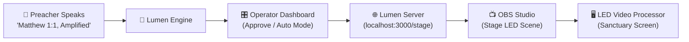

# 05 — OBS Studio & Stage LED Wall Integration

## Overview

Lumen integrates directly with OBS Studio to broadcast verses to the church's sanctuary stage screen.

Instead of an operator frantically typing in EasyWorship during live preaching, Lumen powers a **Sanctuary Stage LED Canvas** (`http://localhost:3000/stage`) that automatically transitions between the church's sermon title slide and high-impact scripture visuals with video motion loops.

---

## The Stage LED Canvas Architecture

---

## Display Endpoints

| Endpoint | Designed For | Visual Style |
|----------|--------------|--------------|
| **`/stage`** | **Sanctuary Stage LED Wall / Projector** | **Full-bleed cinematic canvas** with video motion loop background, readability scrim, and bold modern sans-serif typography. Transitions smoothly between the sermon series slide and scripture. |
| **`/overlay`** | Livestream Broadcast | Transparent lower-third overlay floating above camera feeds. |
| **`/overlay-full`** | Secondary Displays | Full-screen centered scripture display. |

---

## Setting Up the Stage LED Wall in OBS

### Step 1: Add the Browser Source
1. In OBS Studio, select your **Stage LED Wall** scene.
2. Under **Sources**, click **+ → Browser**.
3. Name it: `Lumen Stage LED Wall`.
4. Enter properties:
   * **URL:** `http://localhost:3000/stage`
   * **Width:** `1920` (or the native resolution of your LED processor)
   * **Height:** `1080` (or native height)
   * **FPS:** `30` or `60`
   * ☑ **Shutdown source when not visible**
   * ☑ **Refresh browser when scene becomes active**
5. Click **OK**.

### Step 2: Route to the Sanctuary Screen
* In OBS, right-click the preview area or the scene.
* Select **Fullscreen Projector (Scene) → [Select your LED Wall output display]**.

---

## How the Stage LED Wall Behaves During a Sermon

### 1. Idle State (No Verse Active)
When the pastor is preaching and no scripture has been called out, the LED wall displays:
* The church's **Sermon Series Graphic** (e.g. *"JESUS CHANGES LIVES"*), or
* A subtle ambient stage loop matching auditorium lighting.
* *Note: The operator can toggle between Graphic or Motion Loop in the Lumen Dashboard.*

### 2. Active Scripture State
The moment the preacher calls out a verse (e.g., *"Turn to Matthew 1:1, Amplified version"*):
1. The sermon title graphic smoothly crossfades into the **ambient motion loop**.
2. A semi-transparent **readability scrim** darkens the background so bright areas of the video never wash out the text.
3. The bold sans-serif scripture text fades in with high contrast.
4. The citation badge shows: `MATTHEW 1:1` • `AMPLIFIED`.

### 3. Dismissal & The 5-Minute Safety Ceiling
* **Operator Dismissal:** When the pastor finishes with the passage, the operator clicks **[Clear Stage]** in Lumen, and the screen smoothly dissolves back to the sermon series slide.
* **Instant Replacement:** If the pastor calls out another scripture (e.g. *"Now look at Romans 8"*), the screen crossfades immediately to the new verse.
* **5-Minute Safety Ceiling:** If the operator forgets to clear the verse, Lumen automatically returns the LED wall to the sermon graphic after 5 minutes, ensuring stale verses never linger indefinitely.

---

## Operator Dashboard Features for the LED Wall

1. **Stage Wall Live Status & Timer:** Shows the exact verse live on the stage wall, alongside a live timer (`⏱️ 02:15 / 05:00 max`) and visual progress bar.
2. **One-Click Clear:** Instantly return to the sermon graphic.
3. **Motion Loop URL:** Input an optional `.mp4` / `.webm` video loop URL or file path. If no external video is specified, a built-in ambient luminous stage gradient plays automatically.
4. **Manual Stage Override:** Type any book, chapter, verse, and translation to immediately project it on stage without waiting for speech detection.
